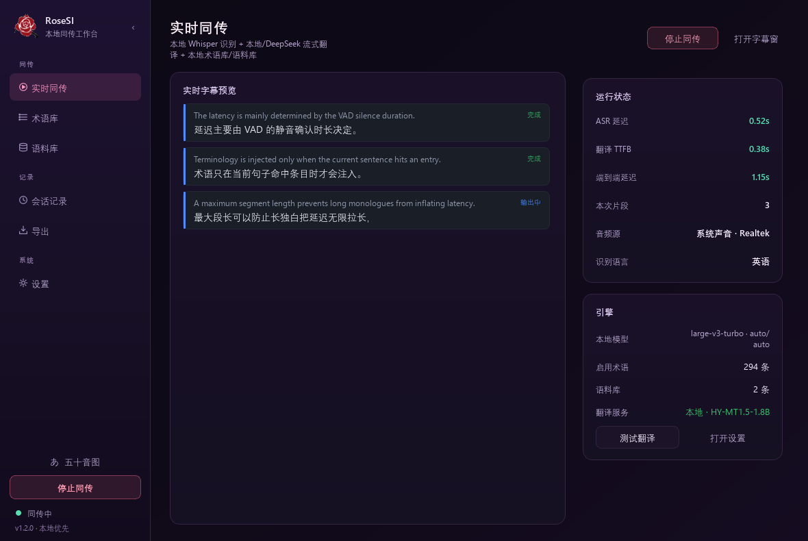
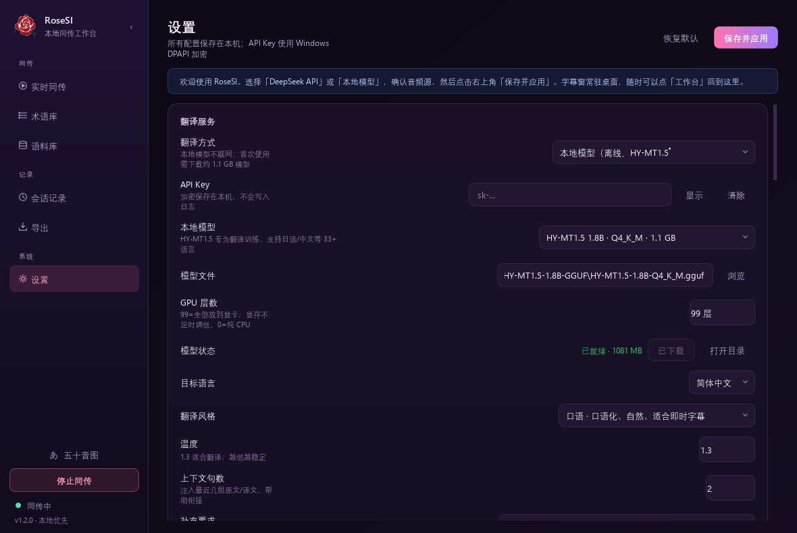
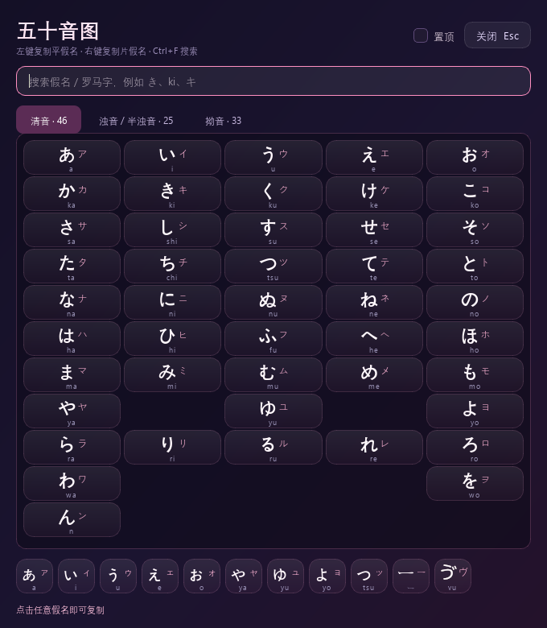
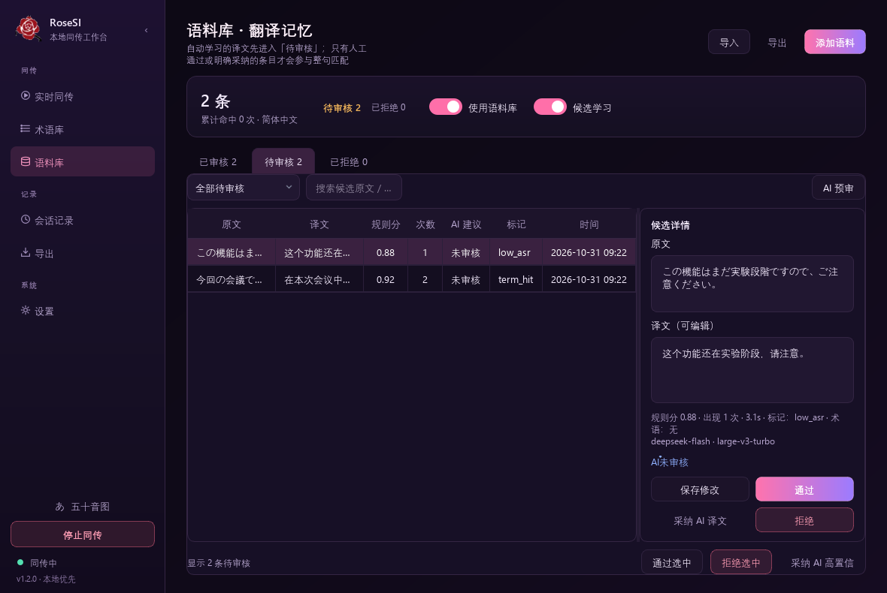

# RoseSI · 本地实时同传

> Windows 桌面端的日语实时字幕 / 同传工具：本地 ASR + 本地或云端翻译 + 术语库 / 语料库。

适合看日语直播、Vtuber、会议、生肉视频，也适合日语学习和复盘。不是网页，而是常驻置顶的原生字幕窗 + 独立工作台。

**当前版本：1.2.0** · Windows 10/11 x64 · 代码 MIT

**作者：无媒介蔷薇** · GitHub：[@rightnowrose](https://github.com/rightnowrose) · Bilibili：[空间主页](https://space.bilibili.com/3747570723589225/dynamic)

- 不是网页：PySide6 原生桌面窗口。
- 字幕窗常驻置顶，可拖动移动、拖动四边/四角调整大小、可鼠标穿透；点「工作台」打开完整功能窗口。
- 术语库、语料库、会话记录全部保存在本机 SQLite；API Key 用 Windows DPAPI 加密。




> 新手建议直接阅读 [RoseSI 用户手册（Word）](docs/RoseSI-User-Manual.docx)；下面保留完整的 Markdown 说明，方便在 GitHub 上搜索和更新。

## 目录

- [下载](#下载)
- [功能](#功能)
- [快速开始](#快速开始)
- [音频源怎么选](#音频源怎么选)
- [字幕窗与五十音图](#调整字幕窗大小)
- [工作台](#工作台)
- [术语库与语料库](#术语库与语料库延迟设计)
- [延迟预算](#延迟预算参考)
- [快捷键](#快捷键)
- [数据与隐私](#数据与隐私)
- [常见问题](#常见问题)
- [开发与测试](#开发与测试)
- [打包与分发](#打包与分发)
- [许可证](#许可证)

## 下载

| 方式 | 适合 | 说明 |
| --- | --- | --- |
| **Windows 安装版（标准）** | 需要开箱即用 | 内置 Parakeet + HY-MT，约 3.41 GB；在 **Releases** 下载 `RoseSI-1.2.0-Setup.exe.part001`、`.part002` 后合并 |
| **RoseSI Lite（在线版）** | 磁盘/下载空间有限 | 不内置模型，安装包约 1.2 GB；首次运行在设置里下载 Parakeet / HY-MT；下载 `RoseSI-1.2.0-Lite-Setup.exe` |
| **便携版（解压版）** | 不想安装 / 放 U 盘 | 当前 Release **暂未上传**独立解压包；可在本地用 `build.ps1` 生成 `dist/RoseSI`。标准构建含模型（约 5.6 GB），Lite 构建不含模型（约 3.4 GB） |
| **从源码运行** | 开发者 | 见[快速开始](#快速开始) |

> GitHub 单个附件上限 2 GiB，所以标准安装包会拆成多个分卷。**必须下载全部分卷**，合并后才能使用。
>
> 仓库本身只包含源码、文档和打包脚本；模型权重与安装包不提交进 Git。

标准版合并（PowerShell / CMD）：

```bat
copy /b RoseSI-1.2.0-Setup.exe.part001 + RoseSI-1.2.0-Setup.exe.part002 RoseSI-1.2.0-Setup.exe
```

Lite 版只有一个文件，不需要合并。合并/下载后核对对应的校验文件（标准版用 `SHA256.txt`，Lite 用 `SHA256-Lite.txt`），再双击安装。

> **关于解压版**：当前 GitHub Release 只有标准安装版和 Lite 安装版，没有独立的解压包。标准安装版是“按用户安装”，不要求管理员权限；如果确实需要免安装目录，可以按[打包与分发](#打包与分发)在本地生成 `dist/RoseSI`，再把整个目录打包分发。

## 功能


| 模块 | 说明 |
| --- | --- |
| 实时字幕窗 | 三种显示模式（专注/双语/学习）、日文/中文字体分离、历史句摘要、术语/记忆命中、上翻「回到最新」、工具栏自动隐藏、多屏定位、拖动调整、置顶、鼠标穿透 |
| 五十音图 | 内置常驻窗口：清音/浊音/拗音、平假名/片假名/罗马字、搜索、点击复制、置顶；快捷键 `Ctrl+Alt+K` |
| 二次元界面 | 深紫夜空 + 樱花粉/霓虹紫配色，渐变卡片与主按钮，字幕窗同步换肤 |
| 音频源 | 系统声音环回（浏览器/播放器/会议软件）、麦克风、浏览器标签页（扩展） |
| 本地 ASR | Parakeet TDT 0.6B JA（日语直播首选，ONNX/CUDA）+ faster-whisper 兼容，Silero VAD 断句 |
| 翻译 | DeepSeek 流式 SSE，或完全本地的 HY-MT1.5 GGUF；可切换服务商；语料库命中时零延迟 |
| 术语库 | 内置日中直播/Bilibili Vtuber 基础库（288 条，只读，可停用/复制）；多个自建库可切换、启用/停用；Aho-Corasick 按句命中 |
| 语料库 | 整句精确/模糊命中；候选审核（规则过滤 + 可选 AI 预审）；导入导出 |
| 会话记录 | 每次同传自动落盘，查看原文/译文/延迟，导出 SRT/TXT/MD/JSON/CSV/Excel |
| 工作台 | 可折叠分组侧栏、全局开始/停止、实时预览、术语库、语料库、会话记录、导出、设置 |
| 系统集成 | 托盘、全局热键、单实例、深色标题栏、日志 |

## 快速开始

### 安装版用户（推荐）

1. 在 **Releases** 下载标准版两个分卷（或 Lite 单文件）。
2. 标准版先合并并核对 `SHA256.txt`；Lite 核对 `SHA256-Lite.txt`。
3. 双击安装包，按向导安装；默认按当前用户安装，不需要管理员权限。
4. 首次启动后进入「设置」：
   - **翻译方式**：选 DeepSeek 并填自己的 API Key；或选「本地模型」并下载 HY-MT（无需 Key）。
   - **音频源**：选浏览器/播放器实际使用的输出设备；只想抓一个标签页时用「浏览器标签页（扩展）」。
   - **目标语言**：简体中文。
5. 点「保存并应用」，再点字幕窗的「开始」或按 `Ctrl+Shift+S`。

> 标准版已内置 Parakeet + HY-MT；Lite 首次使用需在「设置 → 本地识别」和「翻译服务 → 本地模型」里分别下载模型，约 1.2 GB + 1.1 GB。

### 1. 环境

- Windows 10 2004+ / Windows 11，Python **3.10 x64**。
- 安装版约 **5.6 GB** 磁盘空间（含 Parakeet、HY-MT、CUDA/cuDNN 运行时和 Qt）；Lite 在线版安装后约 **3.4 GB**，模型在首次使用时下载。
- 可选 NVIDIA GPU（推荐）；CPU 也能跑，但 large-v3-turbo 在 CPU 上通常无法实时。Parakeet ONNX 需要 CUDA/cuDNN 才能达到直播延迟。
- 不填 DeepSeek Key 也能用：翻译选「本地模型」即可；需要 AI 预审或云端翻译时再填。
- 首次使用：

```bat
setup.bat
```

或手动：

```bat
py -3.10 -m venv venv
venv\Scripts\python.exe -m pip install -r requirements.txt
```

可选组件（不影响只使用 DeepSeek 的基础功能）：

```bat
REM 本地 HY-MT 翻译
venv\Scripts\python.exe -m pip install -r requirements-local.txt

REM Parakeet ONNX（CUDA）
venv\Scripts\python.exe -m pip install -r requirements-parakeet.txt
```

源码运行时模型需要单独下载：见 [3. 模型](#3-模型) 或 `packaging/models.json`；标准安装版已内置 Parakeet + HY-MT，Lite 版需要首次下载。

### 2. 启动

```bat
run.bat
```

或：

```bat
venv\Scripts\python.exe main.py
```

也可以直接在 PyCharm 里运行 `main.py`（解释器选择本项目的 `venv`）。

首次启动会打开工作台「设置」页：

1. 填入 DeepSeek API Key（[platform.deepseek.com](https://platform.deepseek.com)）；不想用云端时，在「翻译方式」选「本地模型」，按 2.1 下载模型即可，不需要 Key。
2. 音频源选择「系统声音（含浏览器）」，并选择浏览器实际使用的输出设备。
3. 目标语言选「简体中文」。
4. 点「保存并应用」。
5. 点字幕窗的「开始」，或按 `Ctrl+Shift+S`。

默认翻译模型是 **`deepseek-flash`**，并**关闭深度思考**——实时字幕必须关闭，否则首包延迟和费用都会明显增加。旧配置里的 `deepseek-chat` / `deepseek-reasoner` 会在首次启动时自动迁移到 `deepseek-flash` 并关闭思考。也可以在工作台「设置 → 深度思考」中手动开关。

### 2.1 本地翻译（可选，无需 API Key）

设置 → 翻译服务 → 服务商选「本地 HY-MT1.5」。首次使用需要两样东西：

1. **推理运行时**：`llama-cpp-python`（CUDA 版，Windows 预编译 wheel，不用自己编译）：

   ```bat
   venv\Scripts\python.exe -m pip install llama-cpp-python==0.3.36 ^
     --extra-index-url https://abetlen.github.io/llama-cpp-python/whl/cu124
   ```

   没有 NVIDIA GPU 时去掉 `--extra-index-url` 即可用 CPU 版（能跑，但速度慢）。

2. **模型文件**：在设置页点「下载模型」，从 hf-mirror 下载 `HY-MT1.5-1.8B-Q4_K_M.gguf`（约 1.1 GB）。也可以手动下载后放进：

   ```text
   %LOCALAPPDATA%\LocalInterpreter\models\HY-MT1.5-1.8B-GGUF\
   ```

   或在设置页「模型文件」里指定任意 GGUF 路径。

   - 默认 **HY-MT1.5 1.8B Q4_K_M**：约 1.1 GB，RTX 3060 6 GB 可全量放到 GPU，速度与质量平衡，日常实时字幕推荐。
   - 可选 **HY-MT1.5 7B Q4_K_M**：约 4.6 GB，质量优先；6 GB 显存建议把「GPU 层数」调到 24–30，剩下的放 CPU。
   - 本地模式不会把原文发到云端；术语表、上下文、语料库同样会注入。首次加载约 2–8 秒，可点「开始同传」预热，之后常驻内存。

本地模型对日译中、英译中的口语文本明显好于 NLLB-200 等传统小模型；如果机器较弱，仍建议用 DeepSeek。HY-MT1.5 使用腾讯 HY 社区许可（不含欧盟/英国/韩国），商用前请自行确认许可条款。



### 3. 模型

#### 3.1 Parakeet TDT 0.6B JA（日语直播首选）

日文直播/实况优先用 **Parakeet TDT 0.6B JA**：ONNX 形态、日语专精，RTX 3060 上 8 秒片段热身后约 **110–140 ms**，比 Whisper 更稳、更快。

模型目录（约 1.3 GB）：

- **安装版（标准）**：已内置在 `安装目录\models\parakeet-tdt-0.6b-ja\`，开箱可用。
- **RoseSI Lite**：不内置；打开「设置 → 本地识别」，在模型状态旁点「下载模型」，约 1.2 GB；下载完成后即可离线识别。
- **源码运行**：放在 `%LOCALAPPDATA%\LocalInterpreter\models\parakeet-tdt-0.6b-ja\`。

```text
models\parakeet-tdt-0.6b-ja\
  encoder-model.fp16.onnx
  decoder_joint-model.fp16.onnx
  nemo80.onnx
  vocab.txt
```

源码运行时若没有模型，执行：

```bat
venv\Scripts\python.exe tools\download_parakeet.py
```

然后在「设置 → 语音识别 → 模型」选 `parakeet-tdt-0.6b-ja`。

运行需要 `onnxruntime-gpu`（CUDA 12 + cuDNN 9）。**安装版已内置 cuDNN 9**，无需额外配置；源码运行时，本机把 cuDNN 放在：

```text
%LOCALAPPDATA%\LocalInterpreter\cudnn\
```

程序启动时会自动加入 DLL 搜索路径；换机器时请把 cuDNN 9 的 `cudnn64_9.dll` 等放到该目录，或确保 CUDA/cuDNN 在 PATH 中。

Parakeet 的原始输出不带可靠标点，程序做了三层处理：VAD 只决定在哪里切音频，文本层再去掉模型误插的句号，用 TDT token 间隔补短句/逗号，避免出现「中心。に」「しまし。た」这类断词。短片段按真实长度送入编码器，不用静音补到 8 秒，否则 TDT 容易把整句退化成 blank（漏句）；只有预热阶段使用 8 秒定长。

直播时额外使用 **滑动草稿**：每隔约 700 ms 对最近几秒音频做一次轻量识别，只有连续两次结果一致的前缀才会上屏，作为原文草稿；最终片段仍然用完整 VAD 音频重新识别。草稿只显示原文，不触发翻译，因此不会把半句送进 API。

断句不是一到静音就立刻切：静音 350 ms 只是候选点，如果草稿还停在「て / で / が / を / から / けど …」这类非句末形式，会再等一小段（最多约 1.2 s）等句子收尾；遇到「です / ます / ました / ください / ね / よ …」则立即定稿。这样减少把一句话切成两段、再让翻译模型补半句的情况。

#### 3.2 faster-whisper（通用/备用，发行版未内置）

`large-v3-turbo` 不再打进发行包，但保留入口和下载方式；在「设置 → 语音识别」中选择后，程序会先查找：

```
%USERPROFILE%\.cache\huggingface\hub\models--mobiuslabsgmbh--faster-whisper-large-v3-turbo
```

本机开发缓存中已有该模型（约 1.6 GB）；发行包不内置。换机器/没有缓存时，faster-whisper 会自动下载；国内网络可先设：

```bat
set HF_ENDPOINT=https://hf-mirror.com
```

也可以在「设置 → 模型路径」直接指定本地 faster-whisper 模型目录。

**日文场景**可以选 `kotoba-whisper-v2.0-faster`（MIT，约 1.5 GB，CTranslate2 格式）：

```text
%LOCALAPPDATA%\LocalInterpreter\models\kotoba-whisper-v2.0-faster\
```

下载后在工作台「设置 → 模型」中选择它，源语言选「日语」。它基于日文微调，标点和汉字通常比原版 Whisper 更稳；本机实测 5 秒日文热身后约 460 ms。也可以继续用 `large-v3-turbo`。

## 音频源怎么选

### 系统声音（推荐，零配置）

抓取所选**输出设备**的 WASAPI 环回。浏览器、播放器、Zoom/Teams 等声音都会进入识别。

- 优点：无需插件，浏览器切标签页也不中断。
- 注意：该设备上的所有声音都会混在一起；请关闭不需要的提示音/音乐。
- 如果浏览器用的是耳机，请在设置里选耳机对应的输出设备。

### 浏览器标签页（扩展，精确选择）

只抓某一个标签页，适合“一边开会/看视频，一边做别的事”。

安装（一次性）：

1. Edge 打开 `edge://extensions/`（Chrome 为 `chrome://extensions/`）。
2. 打开「开发者模式」。
3. 「加载解压缩的扩展」→ 选择本项目的 `extension` 文件夹。
4. 在应用设置里把音频源切到「浏览器标签页（扩展）」并保存。
5. 开始同传，切到目标标签页，点击扩展图标；徽标 **ON** 即正在发送。再点一次停止。

细节见 [extension/README.md](extension/README.md)。

### 麦克风

适合线下会议/当面交流。可在设置中选择具体麦克风。

## 调整字幕窗大小

- 拖动任意**边缘或四角**即可缩放；最小尺寸 520 × 140。
- 只拖左右：宽度改变，高度继续随内容自动伸缩。
- 拖上下或四角：进入手动高度，大小会记入配置，下次启动保持。
- 右键字幕窗 → **自动高度** 可恢复随内容伸缩，或 **重置为默认大小**。
- 设置 → 字幕窗 → 高度：`0` 表示自动，也可以直接填像素值。
- 设置 → 字幕窗 → **历史行数**：默认保留 6 句（加当前句共 7 句），最大 12；超过窗口高度时用鼠标滚轮查看前面的句子。新句子出现时自动滚到底部，向上翻阅时不会被拉回。
- 历史句会自动收小字号，当前句保持主视觉；向上翻阅后右下角出现「回到最新」。
- 同传进行中工具栏会在鼠标离开 2.4 秒后自动变淡，移入窗口即恢复；右键菜单可关闭“自动隐藏工具栏”。
- 右键 → **窗口位置 → 移到指定屏幕** 可把字幕窗放到另一块显示器的底部；位置会记住。

### 三种显示模式

| 模式 | 当前句 | 历史句 | 适合 |
| --- | --- | --- | --- |
| 专注 | 只看译文，26–32 px | 完全隐藏 | 看直播、追番、只想读中文 |
| 双语 | 原文小、译文大 | 只保留一行译文摘要 | 日常同传（默认） |
| 学习 | 原文、译文都完整 | 原文、译文都保留，字号接近 | 复盘、精听、对照学习 |

顶部模式按钮循环切换，也可以右键字幕窗 → 显示模式；设置里可改默认模式。

### 五十音图



- 从字幕窗右键菜单、工作台侧栏「あ 五十音图」、托盘菜单或 `Ctrl+Alt+K` 打开。
- 清音 / 浊音·半浊音 / 拗音三页；每格显示平假名、片假名、罗马字。
- 紧凑网格默认一屏显示整张表，清音/浊音/拗音都不需要滚轮；窗口可自由缩放。
- 左键点平假名复制，右键点片假名复制；支持搜索和置顶。
- 关闭只是隐藏，再次打开会回到原来的位置。

## 工作台

- 左侧栏可按顶部 `‹` 收起为图标栏，再按 `›` 展开，状态会记住；适合小屏或只想看内容时使用。
- 侧栏底部常驻「开始同传 / 停止同传」，不需要回到仪表盘。
- 「语料库」右侧会显示待审核候选数量。

| 页面 | 能做什么 |
| --- | --- |
| 实时同传 | 字幕预览、ASR/TTFB/端到端延迟、音频源、模型/术语/语料库状态、测试 API |
| 术语库 | 新建/重命名/删除多个库；切换编辑；启用开关；行内编辑；搜索；导入 CSV/TSV/XLSX/JSON；导出 |
| 语料库 | 查看/搜索/编辑/删除翻译记忆；启用语料库、候选审核；导入导出；重建索引 |
| 会话记录 | 历史会话、平均延迟、片段数；查看详情；导出 |
| 导出 | 选择会话/格式/双语模式/元数据，保存到任意位置；最近导出列表 |
| 设置 | API、ASR、音频、字幕外观、热键、数据目录 |

关闭工作台只是隐藏到托盘；从字幕窗「工作台」按钮、托盘双击或 `Ctrl+Alt+W` 重新打开。

## 术语库与语料库（延迟设计）

- 运行时把**所有启用库**的术语编译成一个 Aho-Corasick 自动机，常驻内存。
- 每句识别完成后做一次整句扫描（微秒级），只把**当前句命中的术语**写进 prompt。
- 不会把整本术语库塞进 prompt，也不会每句查数据库。
- 语料库（翻译记忆）按句精确命中时直接复用译文，**不调用 API**，延迟为 0；高相似句只作为参考译文注入。
- 自动学习默认只生成**待审核候选**，不会直接写回正式语料库；人工通过后才参与命中。

### 候选审核与 AI 预审



自动学习目前提供两档：`关闭`、`仅生成候选（默认）`；`自动` 模式预留给后续版本。候选不会立即影响翻译，避免一句错译被永久记住。

1. 识别 + 翻译完成后，规则过滤先丢弃空句、语气词、非目标语言、数字不一致、明显复读等噪声。
2. 通过的句子进入 `语料库 → 待审核`，记录原文、译文、规则分、出现次数、ASR 置信度、术语和来源会话。
3. 在待审核页可以逐条编辑、通过、拒绝、恢复，也可以批量通过；只有人工通过的条目会写入正式 `tm`。
4. 可选 **AI 预审**：在 `设置 → AI 语料审核` 里开启，使用同一个 DeepSeek API Key 对候选给出 `通过 / 需人工 / 拒绝` 建议、问题标签和可选修正译文。AI 只是建议，不会直接改人工语料。
5. **自动采纳高置信建议** 默认关闭，且只对规则分 ≥ 0.85、AI 通过、无问题、出现 ≥ 2 次的候选生效；可从待审核页手动「采纳 AI 高置信」。

检索时只读取正式 `tm`，并要求质量分 ≥ 0.8；候选永远不会被直接命中。规则、AI、数据库和界面都不读取音频，AI 只发送文字候选。

### 内置基础术语库

首次启动会自动添加一个只读的 **基础术语库 · 日中直播**，覆盖直播、Bilibili Vtuber、游戏实况、字幕和常见口语，共 288 条。它和用户自建的库**同时参与匹配**，不需要手动合并。

- 基础库默认启用，可在术语库页整体停用，也可以单独取消某条术语的「启用」。
- 基础库不能重命名、删除、增删改术语，避免升级时覆盖用户数据。
- 需要改译法时，点术语库页的 **复制为我的库**，会生成一个可编辑副本；副本和基础库可以同时启用，按优先级/库顺序参与匹配。
- 没有内置 WCC-JC 等影视字幕语料：它们通常是研究许可、体量大，而且影视脚本比直播口语完整；直接用于直播容易把碎句翻得过于书面。外部平行语料建议通过「语料库 → 导入」按需使用。
- 基础术语以高置信度领域词为主，不收录必须依赖上下文才能确定译法的普通词，避免基础库把正常句子改坏。

术语建议：

- 英文缩写/产品名：`VAD → 语音活动检测`，别名可填 `Voice Activity Detection`。
- 中文术语默认不做全词边界；英文/数字默认全词匹配。
- 同一句命中多个库时，优先级高的优先；同一位置原文精确命中优先于别名。

## 延迟预算（参考）

| 阶段 | 典型值 |
| --- | --- |
| VAD 静音确认 | 350 ms（可调 150–1200） |
| 最终 ASR（5 s 语音，RTX 3060） | 400–600 ms |
| Parakeet 最终 ASR（8 s 日文，RTX 3060，热身后） | 约 110–140 ms |
| DeepSeek 首包 | 300–700 ms |
| 本地 HY-MT1.5 首字（GPU，常驻） | 200–600 ms |
| **说完一句到译文首字** | **约 1.1–1.8 s（DeepSeek）** |

说话过程中每 700 ms 更新一次原文增量；句末停顿达到静音阈值才开始翻译。把「静音断句」调小会更快，但更容易把句子切碎。

翻译侧有**背压保护**：默认最多同时保留 2 个待翻译片段；如果识别速度持续快于翻译，程序会取消最旧的片段、优先处理最新句，并在字幕窗底部显示「队列 N / 落后 X.Xs」，避免越积越多却看不出来。被跳过的片段会保留原文并标出「翻译积压，已跳过」。可在配置文件的 `translate.max_pending` 中调整（默认 2）。

## 快捷键

| 功能 | 默认 |
| --- | --- |
| 开始/停止同传 | `Ctrl+Shift+S` |
| 打开工作台 | `Ctrl+Alt+W` |
| 鼠标穿透开关 | `Ctrl+Alt+T` |
| 显示/隐藏字幕窗 | `Ctrl+Alt+H` |

可在设置里修改。`Ctrl+Alt+S` 在很多机器上被其他软件占用，因此默认改成 `Ctrl+Shift+S`；注册失败会在字幕窗提示。

## 数据与隐私

| 内容 | 位置 |
| --- | --- |
| 配置 | `%LOCALAPPDATA%\LocalInterpreter\config.json` |
| 数据库 | `%LOCALAPPDATA%\LocalInterpreter\interpreter.db` |
| 日志 | `%LOCALAPPDATA%\LocalInterpreter\logs\app.log` |
| 导出 | `%LOCALAPPDATA%\LocalInterpreter\exports\` |

- 音频只在内存中处理，不落盘、不上传。
- DeepSeek 模式只有**识别出的文本**会发送到 DeepSeek；本地 HY-MT1.5 模式翻译完全在本机，文本不出本机。术语库/语料库/会话记录始终保存在本机。
- API Key 用当前 Windows 用户的 DPAPI 加密，复制到其他机器无法解密。
- 可用环境变量 `SI_DATA_DIR` 指定便携数据目录。

## 常见问题

### 启动报 CUDA / cuDNN 错误

程序会自动回退 CPU。CPU 下 large-v3-turbo 很慢，建议：

- 安装与 CTranslate2 匹配的 CUDA 12 + cuDNN 9；或
- 在设置里换 `medium` / `small`，并选 `int8`。

### 没有声音 / 一直是“等待声音”

- 确认浏览器确实在播放，且输出设备与设置一致。
- 系统声音模式会抓取整个设备；检查是否被静音。
- 标签页模式确认扩展徽标为 ON，且应用「开始」后状态显示“浏览器标签页已连接”。
- 端口 17866 被占用时，标签页服务会报错。

### DeepSeek 返回 401 / 429

- 401：Key 错误或未保存；点设置里的「测试连接」。
- 429：限流/余额不足；降低并发或稍后重试。程序对 429/5xx 会重试一次。

### 热键没反应

可能被其他软件占用；字幕窗会提示注册失败。换一个组合并保存。

### 字幕窗被鼠标穿透后点不到

按 `Ctrl+Alt+T` 关闭，或从托盘菜单取消「鼠标穿透」。程序重启时会自动关闭穿透，避免找不到窗口。

## 开发与测试

```bat
venv\Scripts\python.exe tools\selftest.py          :: 配置/DB/术语/语料库/导出
venv\Scripts\python.exe tools\test_translate.py    :: 伪 SSE 流式翻译 / 错误处理 / TM 命中
venv\Scripts\python.exe tools\test_local_mt.py     :: 本地 HY-MT1.5 GGUF 翻译烟雾测试
venv\Scripts\python.exe tools\test_candidates.py   :: 候选规则/数据库迁移/审核/语料检索
venv\Scripts\python.exe tools\test_pipeline.py     :: 真实系统环回 + TTS + 演示翻译
venv\Scripts\python.exe tools\test_pipeline_tab.py :: WebSocket 标签页音频 + ASR + 演示翻译
venv\Scripts\python.exe tools\test_kotoba.py      :: Kotoba 日文模型加载/转写
venv\Scripts\python.exe tools\test_parakeet.py    :: Parakeet 日文模型加载/8s 转写（无模型时跳过）
venv\Scripts\python.exe tools\test_live_flow.py    :: 草稿稳定前缀/语义断句/翻译背压
```

生成界面截图（离屏）：

```bat
set QT_QPA_PLATFORM=offscreen
set QT_QPA_FONTDIR=C:\Windows\Fonts
venv\Scripts\python.exe tools\screenshot.py
```

## 目录结构

```
app/
  application.py     应用装配、托盘、热键、单实例、退出
  pipeline.py        音频→ASR→术语→翻译→落盘
  asr.py             Silero VAD 流式切句 + faster-whisper / Parakeet 分支
  asr_parakeet.py    Parakeet TDT ONNX 解码、CUDA/cuDNN 路径、日文断句
  audio.py           系统环回/麦克风采集（soundcard）
  tab_capture.py     浏览器扩展 WebSocket 接收
  translator.py      DeepSeek 流式 SSE + 本地 HY-MT1.5 GGUF + prompt + 语料库
  candidates.py      自动学习候选的规则过滤/质量评分
  reviewer.py        AI 语料预审（DeepSeek JSON，只给建议）
  glossary.py        Aho-Corasick 术语匹配
  base_terms.py      内置日中直播/游戏/字幕基础术语（只读）
  tm.py              翻译记忆（只读取已审核条目）
  db.py / config.py  配置、DPAPI、SQLite
  exporter.py        导出
  ui/                字幕窗、工作台、页面、主题、图标、热键、托盘
extension/           Edge/Chrome MV3 标签页音频扩展
packaging/           PyInstaller spec、构建脚本、模型复制、Inno Setup 安装包脚本
tools/               自检、端到端测试、截图
docs/screenshots/    界面截图
main.py              入口
```

## 打包与分发

发布构建有两套配方：

| 配方 | 是否内置模型 | 安装包 | 安装后 | 输出 |
| --- | --- | --- | --- | --- |
| 标准版 | 是（Parakeet + HY-MT） | 约 3.41 GB，拆两卷 | 约 5.6 GB | `release/RoseSI-1.2.0-Setup.exe` |
| Lite 在线版 | 否 | 约 1.14 GB | 约 3.4 GB | `release/RoseSI-1.2.0-Lite-Setup.exe` |

`dist/RoseSI/` 是 PyInstaller 便携目录，双击 `RoseSI.exe` 即可运行，无需安装 Python。**`dist/RoseSI` 的内容取决于最后一次构建**：标准构建含两个模型，Lite 构建不含；不要把 Lite 目录当成标准版分发。

标准版构建会复制：

- `models/parakeet-tdt-0.6b-ja/`：Parakeet TDT 0.6B JA（ONNX，日语直播首选）；
- `models/HY-MT1.5-1.8B-GGUF/HY-MT1.5-1.8B-Q4_K_M.gguf`：本地日→中翻译模型。

Whisper large-v3-turbo 不再打进安装包，但保留入口和下载地址：`packaging/models.json` 列出全部 ASR / MT 的下载页；在「设置 → 语音识别 / 翻译服务」里也可以直接切换或下载。程序运行后模型和会话数据写入 `%LOCALAPPDATA%\LocalInterpreter`，安装目录只读即可。

重新构建标准版：

```bat
powershell -ExecutionPolicy Bypass -File packaging\build.ps1
"C:\Program Files (x86)\Inno Setup 6\ISCC.exe" packaging\installer.iss
```

重新构建 Lite 在线版：

```bat
powershell -ExecutionPolicy Bypass -File packaging\build.ps1 -Lite
"C:\Program Files (x86)\Inno Setup 6\ISCC.exe" /DLite packaging\installer.iss
```

`build.ps1` 会先跑 PyInstaller，再按配方复制模型；`installer.iss` 生成安装包到 `release`。打包版可通过 `RoseSI.exe --package-check` 输出自检 JSON（模型路径、运行时、API Key 是否为空等）。数据目录沿用 `%LOCALAPPDATA%\LocalInterpreter`，避免升级时丢失已有配置和模型。

> 标准版、Lite、便携目录都不包含任何 DeepSeek API Key。首次启动时 `api_key_enc` 为空；用户需要在设置里填写自己的 Key，Key 只保存在本机 DPAPI 中。

## 已知限制

- 目前只在 Windows 上验证；macOS/Linux 需要替换音频与热键实现。
- 「系统声音」是设备级环回，不能按应用隔离；要按标签页请用扩展。
- 翻译按句提交，不是逐词同传；静音断句决定了下限延迟。
- 首次加载 CUDA 模型约 3–6 秒；模型常驻后再次开始会快很多。
- 本地 HY-MT1.5 需要 `llama-cpp-python` 和 GGUF 模型；不装也能用 DeepSeek，不影响原有功能。
- 标准版安装包约 3.41 GB（拆两卷），安装后约 5.6 GB（含 Parakeet、HY-MT、cuDNN、CUDA 运行时和 Qt）；Lite 安装包约 1.14 GB，安装后约 3.4 GB，模型首次使用时下载。单文件（onefile）启动时会解压数 GB，不推荐。

## 许可证

本项目代码采用 **MIT License**，见 [LICENSE](LICENSE)。

Copyright © 2026 无媒介蔷薇（RoseSI contributors）。

作者：**无媒介蔷薇** · GitHub：[@rightnowrose](https://github.com/rightnowrose) · Bilibili：[space.bilibili.com/3747570723589225](https://space.bilibili.com/3747570723589225/dynamic)

模型权重和第三方运行时不在 MIT 授权范围内：

- Tencent HY-MT1.5：Tencent HY Community License（见 `LICENSES/HY-MT1.5-License.txt`）；
- Parakeet TDT 0.6B JA：CC-BY-4.0；
- faster-whisper / Whisper、PySide6、llama-cpp-python、ONNX Runtime 等：见 `THIRD_PARTY_NOTICES.md` 与各自发行许可。

仓库不提交模型权重；安装包内置模型时，请同时遵守对应模型许可证。


